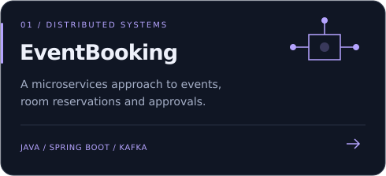
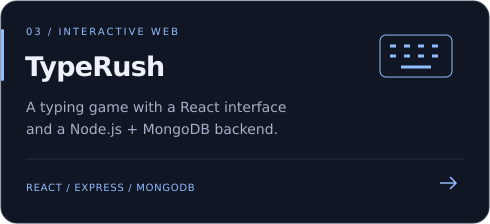

  

  
  

### A little about me

I'm Deep, a Full Stack Developer based in Toronto. At Vision Infotech I build Spring Boot APIs and React interfaces for enterprise web applications, and outside work I build side projects to go deeper on system design: an interface people can use, the APIs behind it, and the data that makes it work.

My projects span **Java microservices**, **TypeScript and Node.js backends**, and **React and React Native apps**. I also explore data analysis through Python notebooks.

> Make it useful. Understand how it works. Keep improving it.

 

### 01 / Selected work

A few projects that show the different things I like to build. Select a card to explore the code.

<table>
  <tr>
    <td width="50%"></td>
    <td width="50%"></td>
  </tr>
  <tr>
    <td width="50%"></td>
    <td width="50%"></td>
  </tr>
</table>

**More to explore:** [Flashify](https://github.com/Deep1454/Flashify) · [Employee Manager](https://github.com/Deep1454/101410218_comp3133_assignment2) · [Real-time Chat](https://github.com/Deep1454/101410218_lab_test1_chat_app) · [Travelometer](https://github.com/Deep1454/Travelometer) · [Data Analysis Notebook](https://github.com/Deep1454/data_analyst_Assignment)

 

### 02 / My toolkit

  

| Area | Technologies used across my projects |
| :--- | :--- |
| **Backend & APIs** | Java · Spring Boot · Node.js · Express · TypeScript · GraphQL · Socket.IO |
| **Web & mobile** | React · React Native · Expo · Angular · HTML · CSS |
| **Data & persistence** | PostgreSQL · MongoDB · SQL Server · Python · Jupyter |
| **Architecture & tooling** | Microservices · Kafka · Keycloak · Docker · Git |

<b>See the stack in action</b>

- **EventBooking:** service boundaries, REST APIs, Kafka, Docker, PostgreSQL and MongoDB.
- **GitNarrate:** GitHub and GitLab OAuth 2.0 sign-in, background jobs with BullMQ and Redis, PostgreSQL with Prisma and Slack publishing.
- **XploreOn:** React Native screens, REST and GraphQL API integration and Firebase authentication.
- **TypeRush:** React UI, Express routes, MongoDB models and JWT authentication.
- **Flashify:** mobile navigation, flashcard folders and AI service integration.
- **Employee Manager:** Angular, TypeScript, GraphQL and authentication. [Backend repository →](https://github.com/Deep1454/COMP3133_101410218_Assignment1)
- **Real-time Chat:** Socket.IO rooms, group and private messages, typing indicators and message history.
- **Travelometer:** ASP.NET Core MVC, Entity Framework Core and identity-based accounts.

 

### 03 / Let's build something useful

Interested in web apps, mobile development, backend systems or a project we could build together? Connect with me on [LinkedIn](https://www.linkedin.com/in/deeplakhani) or reach me at [deeplakhani60@gmail.com](mailto:deeplakhani60@gmail.com).

---

Deep Lakhani · <a href="https://github.com/Deep1454">@Deep1454</a> · Always learning through building.

