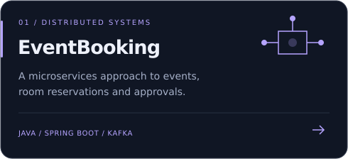
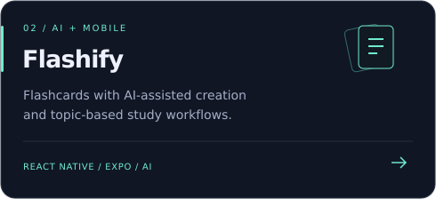
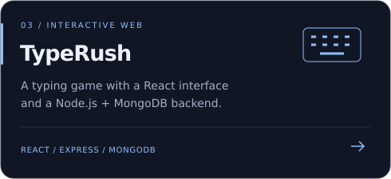
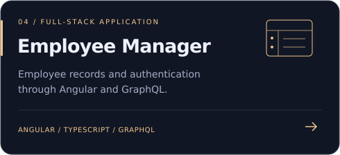

<!-- Profile repository: Deep1454/Deep1454. Upload the assets folder with this README. -->

  

  
  

### A little about me

I'm Deep, a developer who enjoys connecting the whole picture: an interface people can use, the APIs behind it, and the data that makes it work.

My projects span **Java microservices**, **JavaScript and TypeScript web apps**, and **React Native mobile experiences**. I also explore data analysis through Python notebooks.

> Make it useful. Understand how it works. Keep improving it.

 

### 01 / Selected work

A few projects that show the different things I like to build. Select a card to explore the code.

<table>
  <tr>
    <td width="50%"></td>
    <td width="50%"></td>
  </tr>
  <tr>
    <td width="50%"></td>
    <td width="50%"></td>
  </tr>
</table>

**More to explore:** [Real-time Chat](https://github.com/Deep1454/101410218_lab_test1_chat_app) · [Travelometer](https://github.com/Deep1454/Travelometer) · [Data Analysis Notebook](https://github.com/Deep1454/data_analyst_Assignment)

 

### 02 / My toolkit

  

| Area | Technologies used across my projects |
| :--- | :--- |
| **Web & mobile** | React · Angular · React Native · Expo · HTML · CSS |
| **APIs & services** | Node.js · Express · Java · Spring Boot · GraphQL · Socket.IO |
| **Data & persistence** | MongoDB · PostgreSQL · SQL Server · Python · Jupyter |
| **Architecture & tooling** | Microservices · Kafka · Docker · Keycloak · Git |

<b>See the stack in action</b>

- **EventBooking:** service boundaries, REST APIs, Kafka, Docker, PostgreSQL and MongoDB.
- **Flashify:** mobile navigation, flashcard folders and AI service integration.
- **TypeRush:** React UI, Express routes, MongoDB models and JWT authentication.
- **Employee Manager:** Angular, TypeScript, GraphQL and authentication. [Backend repository →](https://github.com/Deep1454/COMP3133_101410218_Assignment1)
- **Real-time Chat:** Socket.IO rooms, group and private messages, typing indicators and message history.
- **Travelometer:** ASP.NET Core MVC, Entity Framework Core and identity-based accounts.

 

### 03 / Let's build something useful

Interested in web apps, mobile development, backend systems or a project we could build together? Explore my repositories and connect with me on [GitHub](https://github.com/Deep1454).

---

Deep Lakhani · <a href="https://github.com/Deep1454">@Deep1454</a> · Always learning through building.

